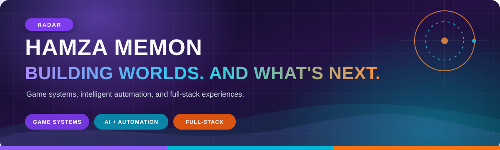

<div align="center">

### Game & Software Developer · World-builder at heart

I build game systems, intelligent automation, and full-stack experiences.

[](https://hamzamemon.me)
[](https://www.linkedin.com/in/hamzamemon-/)
[](mailto:hello@hamzamemon.me)

<sub>Mumbai, India · Also known as <strong>RADAR</strong></sub>

</div>

## Right now

- Building **MAGNATE**, a Monopoly-inspired strategy game about property, risk, and financial decisions
- Working at **NSE Cogencis** on web crawling, financial-data extraction, OCR, and document-processing pipelines
- Exploring interactive simulations, game engines, connected devices, and useful applications of AI

## Featured projects

### [Falcon9Sim](https://github.com/HamzaMemon-G/Falcon9Sim)

A browser-based launch and landing simulation. Follow a Falcon 9-style mission through ascent, stage separation, booster return, and touchdown with live telemetry.

`Three.js` `JavaScript` `Vite` `Simulation`

### [Pathfinding Visualizer](https://github.com/HamzaMemon-G/Algorithm_Pathfinding_Visualizer)

An interactive grid for watching A*, Dijkstra, BFS, and DFS find their way through obstacles from start to finish.

`C++` `SFML` `Algorithms` `Visualization`

### [DISARM-AI](https://github.com/HamzaMemon-G/DisarmAI)

AI-assisted disaster response with flood-risk analysis, intelligent resource allocation, and location-based citizen alerts. Awarded **4th place at TechSprint 2025**.

`Python` `AI/ML` `Environmental data` `Mobile alerts`

### More builds

- [**Smart Parking**](https://github.com/HamzaMemon-G/smart_parking_system) — QR-based parking reservations, entry, expiry, and billing
- [**NexView**](https://github.com/HamzaMemon-G/nexview) — Full-stack video sharing, uploads, content management, and playback
- [**Eval AI**](https://github.com/HamzaMemon-G/evala) — Automated AI-model evaluation and comparison dashboard

## My loadout

```text
Game development   Unity · Unreal Engine · C++ · C# · Lua · Java
Web & backend      Next.js · React · TypeScript · Django · FastAPI · Node.js
AI & automation    Python · Machine learning · OCR · Data pipelines · Discord bots
Beyond the screen  IoT · ESP32 · Docker · Git · System programming
```

## Research

I co-authored and presented **Machine Learning for Early Disease Detection: A Hybrid Ensemble Framework Integrating Multi-Modal Clinical Data** at **IEEE ASIACONF 2026**.

[Read the research paper →](https://hamzamemon.me/research/early-disease-detection.pdf)

## Behind the build

I'm an Electronics & Computer Science student who enjoys making the pieces behind an experience work: the game logic, the backend, the automation, and the infrastructure connecting it all. I've founded gaming communities, built their internal systems, and worked across game development, web and mobile apps, AI/ML, IoT, and realistic simulation.

When I'm away from the editor, you'll usually find me flying on IVAO, racing, or exploring another game world from the player's side.

<div align="center">

### Let's make something play.

Have a game, app, simulation, or ambitious idea? [Send me a message](mailto:hello@hamzamemon.me) or explore the full story at [hamzamemon.me](https://hamzamemon.me).

</div>
